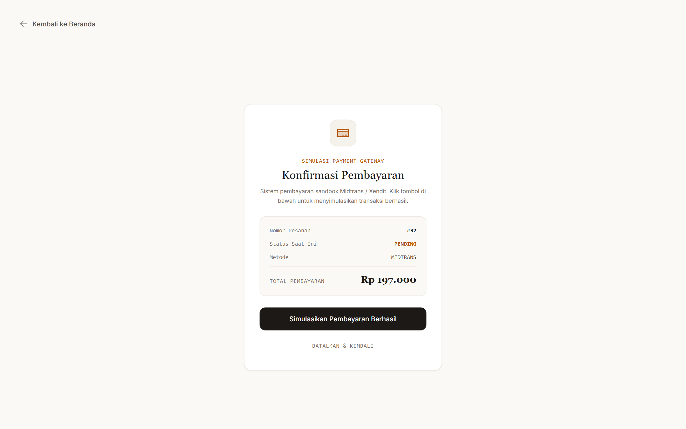
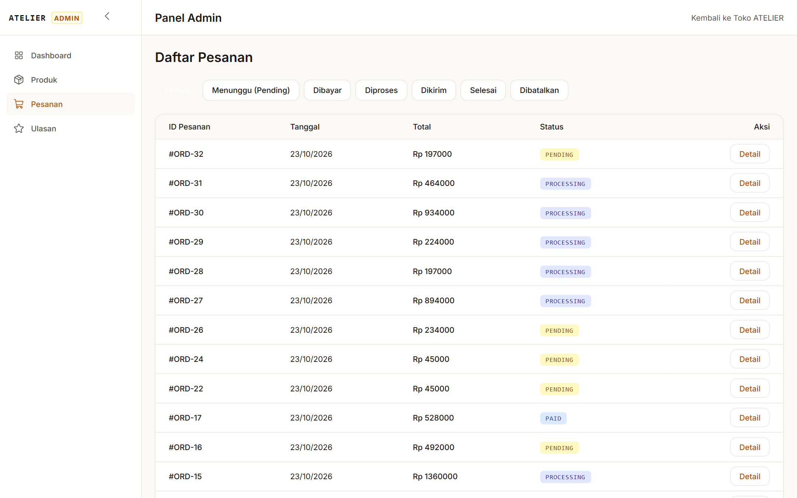
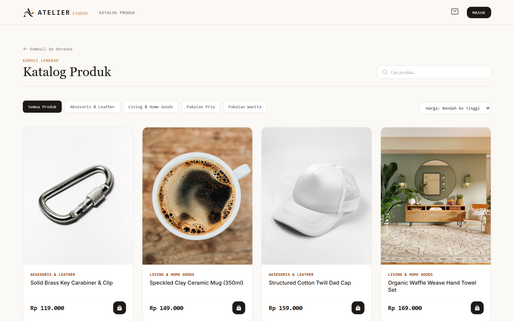
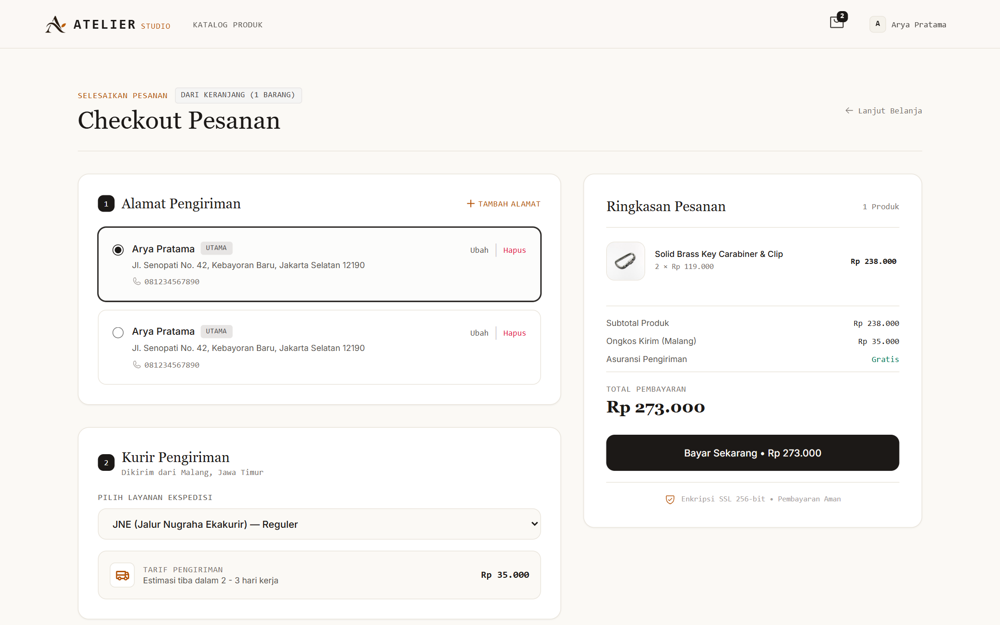

# ATELIER Studio — E-Commerce Backend API

Backend RESTful API yang tangguh, aman, dan berkinerja tinggi untuk mendukung ekosistem toko online modern **ATELIER Studio**. Dibangun menggunakan **Node.js**, **Express**, **TypeScript**, **Prisma ORM**, dan **MySQL**.

---

## 📸 Antarmuka Integrasi Pembayaran & Backoffice

<p align="center">
  
  <br/>
  <em>Integrasi Payment Gateway Simulasi Webhook & Callback Status Transaksi (Midtrans & Xendit)</em>
</p>

<p align="center">
  
  <br/>
  <em>Dashboard Pemantauan & Update Status Siklus Pesanan (Pending, Paid, Processing, Shipped, Completed, Cancelled)</em>
</p>

<details open>
<summary><strong>Lihat Preview Antarmuka Terkait Lainnya ▾</strong></summary>

| Modul | Preview Antarmuka |
|---|---|
| **Storefront & Katalog Produk**<br/>Dukungan dynamic price sorting (asc/desc), kategori, dan pagination. |  |
| **Checkout & Validasi Transaksi**<br/>Validasi stok pesanan aman dan kalkulasi total ongkos kirim. |  |

</details>

---

## 🏗️ Tech Stack

- **Runtime & Bahasa**: Node.js v20+, TypeScript 5.x
- **Framework Web**: Express.js
- **Database & ORM**: MySQL 8.x, Prisma ORM
- **Validasi Skema**: Zod
- **Autentikasi & Keamanan**: JWT (Access Token & Rotating Refresh Token), bcryptjs, CORS, Helmet
- **Integrasi Pembayaran**: Midtrans Snap / Webhook & Xendit Invoice Simulation
- **Penyimpanan Media**: Cloudinary SDK (Upload Gambar Produk Multi-Varian)
- **Dokumentasi API**: Swagger UI & OpenAPI 3.0

---

## 🌟 Keunggulan Rekayasa & Fitur Backend

- **Transaksi Database Atomik**: Menggunakan Prisma `$transaction` dengan mekanisme locking baris pesanan untuk menjamin deduksi stok tidak pernah mengalami *double-spending* atau *race conditions*.
- **Otomasi Siklus Pesanan**: Penjadwalan pembatalan otomatis (*auto-cancel*) pesanan tertunda (*pending*) yang melewati batas waktu 24 jam dengan pemulihan kuantitas stok otomatis.
- **Dynamic Sorting & Filtering**: Validasi dan pemrosesan sorting harga (`price_asc`, `price_desc`) serta tanggal terbaru (`newest`) secara dinamis pada repository database.
- **Idempotent Payment Webhook**: Penanganan callback webhook pembayaran yang tahan terhadap redelivery dan kegagalan jaringan sementara.
- **Autentikasi Dual-Token**: Akses token berdurasi singkat dengan *cookie-based* / header-based refresh token rotation untuk perlindungan terhadap token theft.
- **Relasi Produk Multi-Gambar**: Skema database yang mendukung multi-gambar produk resolusi tinggi dengan keterkaitan berjenjang (*cascade delete*).

---

## 🚀 Memulai (Getting Started)

### 1. Instalasi Dependensi
```bash
npm install
```

### 2. Konfigurasi Environment
Salin template konfigurasi `.env`:
```bash
copy .env.example .env
```
Sesuaikan variabel environment utama:
```ini
PORT=8000
NODE_ENV=development
DATABASE_URL="mysql://root:@localhost:3306/ecommerce_db"
CORS_ORIGIN="http://localhost:3000"
JWT_ACCESS_SECRET="your-access-secret-key"
JWT_REFRESH_SECRET="your-refresh-secret-key"
JWT_ACCESS_EXPIRES_IN="15m"
JWT_REFRESH_EXPIRES_IN="7d"
```

### 3. Setup Database & Migrasi
Buat database dan jalankan Prisma migration:
```bash
npm run prisma:migrate:deploy
```
Jalankan seeder untuk mengisi data awal (kategori, produk luxury, alamat, dan akun pengguna):
```bash
npm run db:seed
```

### 4. Menjalankan Server
Mode Development (Hot-Reload):
```bash
npm run dev
```
Mode Production:
```bash
npm run build
npm start
```

---

## 📖 Dokumentasi API (Swagger)

Setelah backend berjalan, dokumentasi interaktif API dapat diakses di:
- **Swagger UI**: `http://localhost:8000/docs`
- **Spesifikasi OpenAPI JSON**: `http://localhost:8000/docs/json`

---

## 👥 Akun Uji Coba (Demo Credentials)

| Peran | Email | Password |
|---|---|---|
| **Admin** | `admin@atelier.id` | `Admin12345!` |
| **Customer** | `arya.pratama@gmail.com` | `Customer12345!` |

---

## 🔗 Repositori Terkait

- **Frontend Toko & Admin (Nuxt 4)**: [e-commerce_frontend](https://github.com/Salman-artz/e-commerce_frontend)
